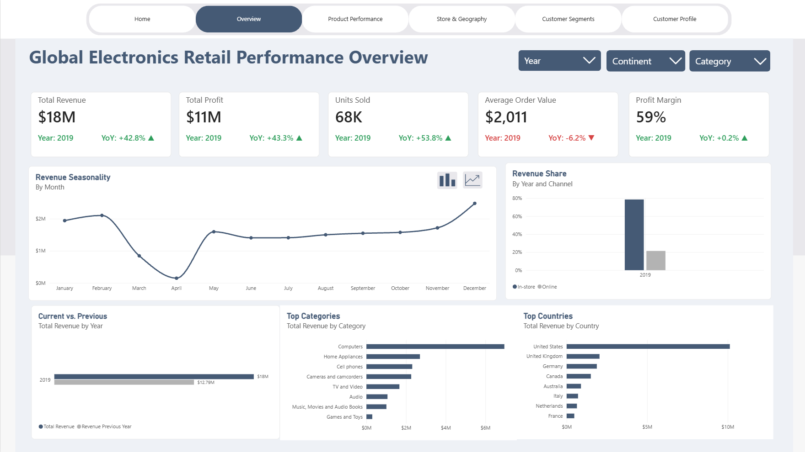
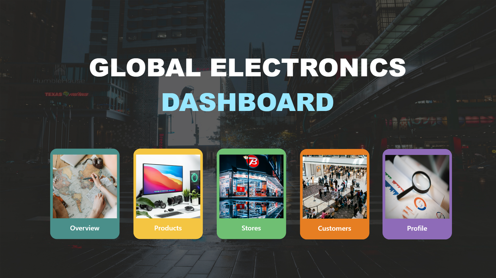
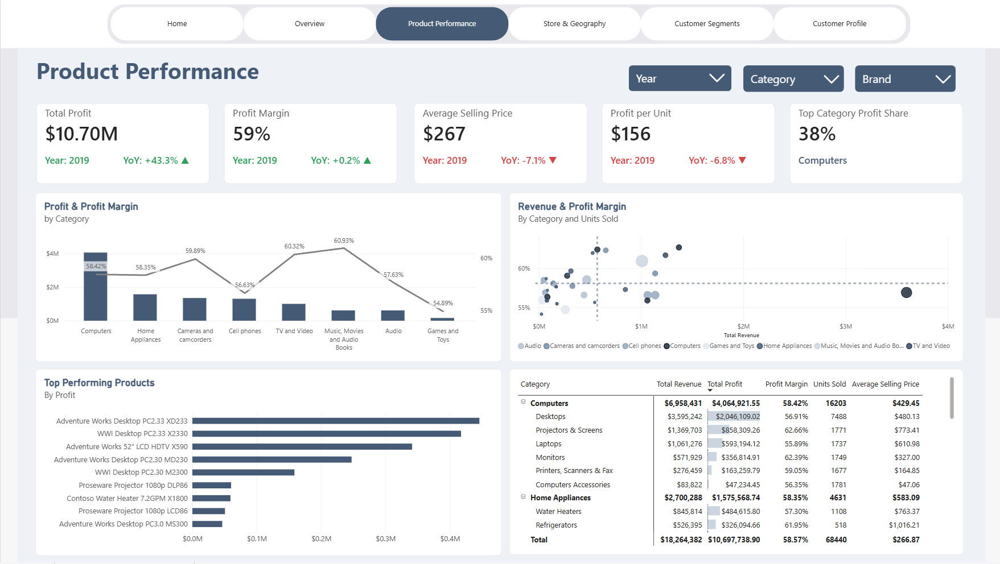
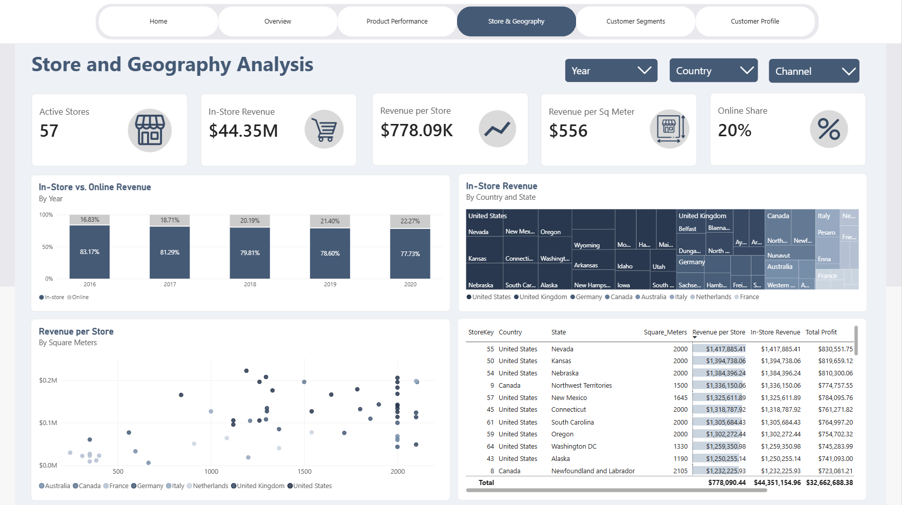
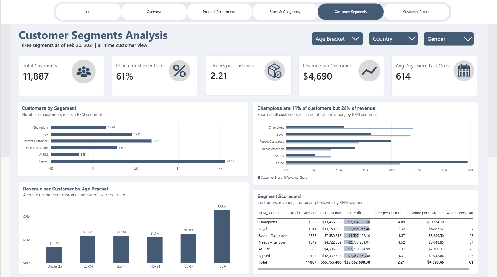
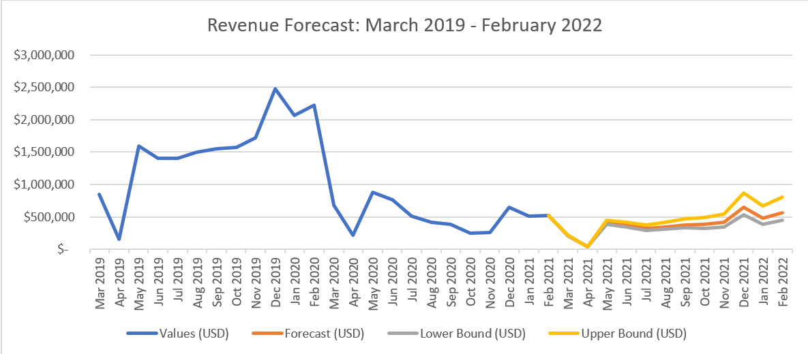

# Global-Electronics-Retail-Performace-Analysis
An end-to-end data analysis project exploring sales performance, profitability, and customer behavior for a global electronics retailer using SQL Server, Excel, and Power BI.

The goal is to identify business trends, evaluate profitability, and uncover opportunities to improve revenue and customer performance.

##  Dashboard Preview

## Main Problem
This business analysis project aims to investigate how can a global electronics retailer increase profitability, improve sales performance, and make better customer decisions using historical sales data. Specifically, the projects aims to answer the following questions:
1. How do revenue and profit change over time, and which months are strongest?
2. Which product categories, brands, and countries generate the most revenue and profit?
3. Which products have high revenue but low profit margins?
4. How do online and in-store channels and individual stores compare?
5. How do customer age, gender, and country relate to purchasing behavior?
6. How much of total profit comes from the highest-value customers?
7. Which customer segments (RFM) should the business retain, grow, or win back?
8. What is the expected revenue over the next months under different scenarios?

## Key Findings
Totals below use 2016 to 2020 (full years): about $54.7M revenue and $32.1M profit, a 58.6% gross margin.

**Revenue and profit over time**
1. Revenue grew from $6.95M in 2016 to $18.26M in 2019, then fell 49.1% in 2020 to $9.29M.
2. Profit moved in line with revenue, and the margin stayed between 58.4% and 59.1% every year.
3. The swings came from order volume, not from pricing or cost.
4. The 2020 drop started in March. The revenue declined from $2.23M in February to $0.67M. Preceding months shown that the revenue had not recovered by Q1 2021 (-79% year over year).
5. Q4 was the strongest quarter every year from 2016 to 2019. By month, February (index 1.65), December (1.64), and January (1.40) are the strongest, and April (0.15) is the weakest.

**Top categories, brands, and countries**
1. Computers lead with 34.5% of revenue and $11M profit, followed by Home Appliances with 19.6% of revenue.
2. The top four categories are Computers, Home Appliances, Cameras, Cell phones, which make up about 77% of revenue.
3. Least performing categories are Games and Toys and Music, Movies and Audio Books.
4. Adventure Works (21.2% of revenue, $6.8M profit), Contoso (19.4%), and Wide World Importers (16.5%) together make up 57% of revenue.
5. The United States generates 53.4% of revenue and profit ($17.1M), then the UK (12.8%) and Germany (9.8%). US customers also place the most orders (2.45 each) and earn the most profit per customer ($3,015).
6. Cell phones have high revenue but low margin, that is 11.0% of revenue but 10.6% of profit, at a 56.6% margin. By brand, The Phone Company (56.7%) and Tailspin Toys (54.6%) have the lowest margins.
7. The least profitable products are low-priced accessories (USB cables, fan parts) earning $7 to $19 each at about 49% margin.
8. The top 10 products are desktop computers and 52" LCD TVs, all at a 66.9% margin, and together they make up roughly 9% of profit.

**Demographics and buying behavior**
1. Age and gender barely change behavior. Profit per customer is $2,660 to $2,804 across age brackets, and $2,755 (male) vs $2,741 (female).
2. Orders per customer are about 2.2 in every group.
3. The 65+ group is the largest contributor (31% of customers and 31% of profit).
4. Across 11,887 customers, average lifetime profit is $2,748 but the median is $1,681, so a smaller group of high-value customers pulls the average up.
5. 61% are repeat customers.
6. Champions and Loyal customers are 27% of customers but 47.7% of profit.
7. Lapsed is the biggest segment, which consists of 34.5% of customers and 21.6% of profit, with last order about 1,039 days ago.
8. At Risk is only 5.5% of customers but 8.4% of profit, at $4,182 per customer (second only to Champions).
9. Cohorts: first-year profit per customer is steady for 2016 to 2019 ($1,730 to $1,930), and first-year orders rose from 1.22 (2016) to 1.55 (2018).

**Revenue Forecast**
In this section, I identify what revenue the business can expect for the next 12 months (Mar 2021 - Feb 2022) using the following methods:
1. Estimate a seasonal index for each calendar month (revenue divided by its centered 12-month average, averaged by month). The last month used to estimate indices is July 2019, so that no 2020 data enters the seasonal trend.
2. Deseasonalize revenue and take the average of the last 3 months (Dec 2020 to Feb 2021) as the current level ($381K per month).
3. Forecast = seasonal index × current level × (1 + monthly growth)^n.

I also make assumptions to simulate 3 possible scenarios:
| Scenario | Monthly Growth | Assumption |
|---|---|---|
| Lower bound | -2% | The 2020 declines continues at a milder rate than 2020.|
| Base | 0% | Current level continues with no recovery nor further decline. |
| Upper bound | 3% | A return to 2019's pace. |

With that, I have accumulated the following results:
| Scenario | Next 12 months | vs. Last 12 months |
|---|---|---|
| Lower bound | $3.93M | -34.8% |
| **Forecast(Base)** | **$4.58M** | **-24.2%** |
| Upper bound | $5.75M | -4.7% |

## Data Source
Source: [Global-Electronics-Retailer](https://mavenanalytics.io/data-playground/global-electronics-retailer)

## Tools and Approach
1. SQL Server: Query, clean, transform, and analyze the data.
2. Excel: Inspect data and perform preliminary checks where needed.
3. Power BI: Build interactive dashboards and visualize key performance indicators.

## How to Reproduce
1. Clone or download this repository.
2. Open the SQL scripts in SQL Server Management Studio.
3. Run all the SQL queries located in the Main_views folder.
4. Open the Power BI report in Power BI Desktop.
5. Connect to the required data source. In the Main_views folder, select the ge.vw_sales_products_fact, ge.vw_customer_segments, and ge.vw_customer_value_decile. Also, select the Store.csv at the Data folder.

## Screenshots of the Dash board

## Revenue Forecast Chart

