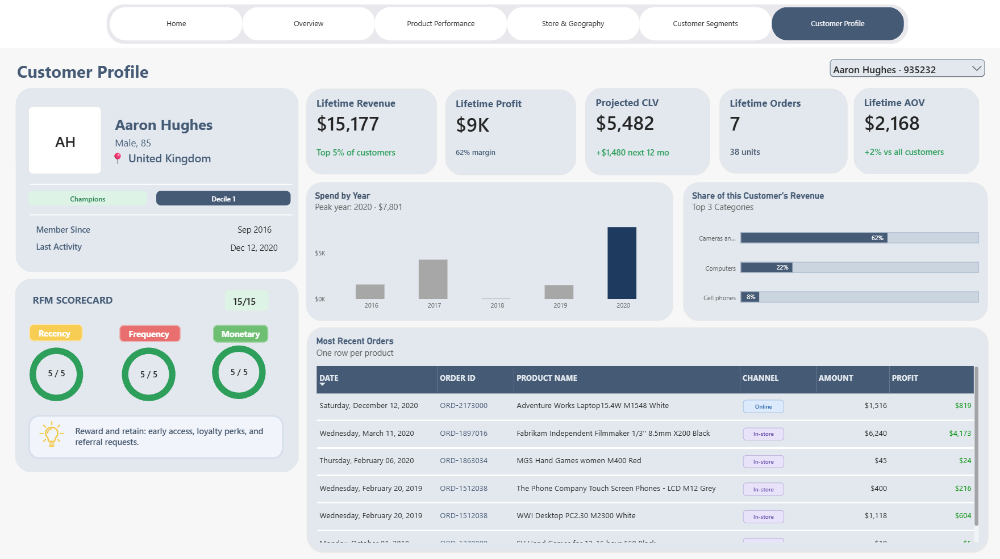

# Global-Electronics-Retail-Performace-Analysis
An end-to-end data analysis project exploring sales performance, profitability, and customer behavior for a global electronics retailer using SQL Server, Excel, and Power BI.

The goal is to identify business trends, evaluate profitability, and uncover opportunities to improve revenue and customer performance.

##  Dash Board Preview

